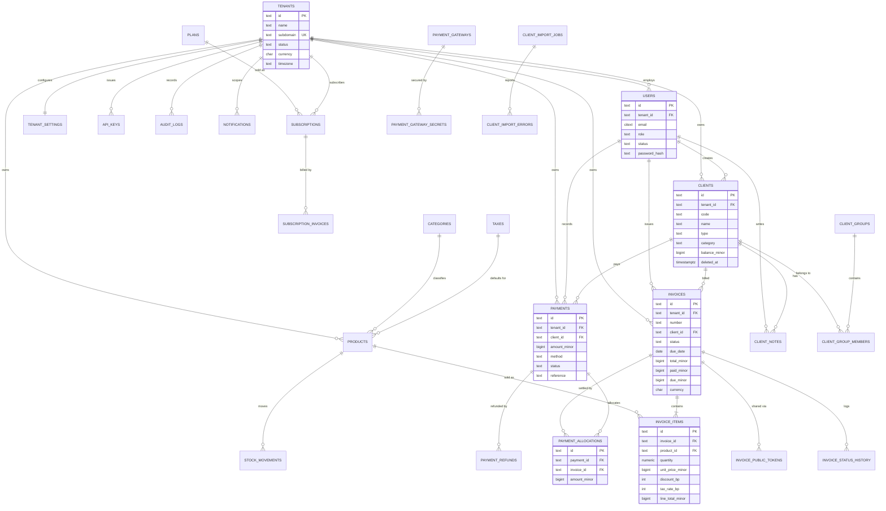

# Phase 2 — Backend Architecture & Design

**Project:** ERP (Valora/Velora) — backend for the existing Next.js ERP frontend
**Repository:** `hamzasekmane/erp` · **Branch:** `arena/3127357b-erp`
**Input:** `docs/01-frontend-audit.md` (Phase 1, binding)
**Date:** 2026-11-09
**Status:** Design proposal. **No backend code has been written.** Implementation starts only after the user confirms this document (see §19).

---

## 1. Purpose, constraints and scope

### 1.1 Goal

Deliver a production-oriented backend that makes the **existing frontend** work end-to-end, without inventing features and without breaking the 68 wired routes catalogued in Phase 1.

### 1.2 Hard constraints inherited from the audit

| # | Constraint | Source |
|---|---|---|
| C1 | Multi-tenant, every entity scoped by `tenantId` derived from the JWT (frontend never sends it) | Audit §12.5 |
| C2 | Bearer JWT auth; login returns `{ token, user, tenant }`; register returns `{ token, user, tenant }` | Audit §9.1 |
| C3 | Subscription-expired contract: `403` + `{ error_code: "SUBSCRIPTION_EXPIRED", data: { expiredSince, daysOverdue } }` | Audit §12.4 |
| C4 | IDs are Mongo-style `_id` strings; `id` also consumed in the subscription/gateway modules | Audit §11.4 |
| C5 | Pagination `{ total, page, limit, pages }`; lists filtered by query params already sent by the UI | Audit §8.3 |
| C6 | Invoice totals are currently computed client-side; server must become authoritative | Audit §9.7.1 |
| C7 | 25 contract conflicts (IC-01…IC-25) need an explicit resolution | Audit §10 |
| C8 | 39 static routes define no endpoints and must not silently expand scope | Audit §15, Q-01 |
| C9 | JSON only — the frontend interprets HTML/404 as "endpoint missing" and fabricates mock data | Audit §8.4 |
| C10 | Response `message` is user-facing French; `errors[]` is `{ field, message }` | Audit §8.4 |

### 1.3 Scope of the v1 backend

**In scope (release 1):** identity & tenancy, users/roles, clients (+groups, notes, import), catalog (products, categories, taxes), invoices (+PDF, public portal), payments (+allocations, refunds, reconciliation, gateways config), dashboard aggregation, notifications, subscription (read + change/cancel), reports (sales/payments/clients/products/aging/export), API keys, admin (tenants, metrics), audit log.

**Out of scope for release 1 (deferred, Q-01):** HR module, archives/restore, support ticketing, email/SMS/backup consoles, advanced analytics screens (forecast/benchmark/pivot), subscription self-service plan builder and analytics, invoice template persistence, security settings page, real gateway processing (Stripe/PayPal live flows).

---

## 2. Architecture decisions (ADR summary)

| ADR | Decision | Rationale | Alternatives rejected |
|---|---|---|---|
| ADR-01 | **Modular monolith** (single deployable, strict internal module boundaries) | One team, one database, ERP workflows are transactional (invoice ↔ payment ↔ stock ↔ balance); distributed transactions would dominate complexity before scale exists | Microservices (premature), serverless functions (cold starts, connection limits, cross-module transactions) |
| ADR-02 | **Node.js 22 + TypeScript + NestJS 11** | Same language/type system as the frontend; reuse Zod contracts; Nest's DI + module system maps 1:1 to the module boundaries; first-class OpenAPI generation | Fastify-from-scratch (less structure), Go/Java (context switch, slower delivery), Next.js API routes only (no worker/queue, weak domain layering) |
| ADR-03 | **PostgreSQL 16** as system of record | Strong constraints, transactions, `SELECT … FOR UPDATE`, partial/unique indexes, `numeric`, JSONB, partitioning, mature backups; ERP data is relational | MongoDB (the legacy `_id` hints at it, but money/inventory invariants need constraints), MySQL (weaker partial indexes/JSONB) |
| ADR-04 | **String IDs (UUIDv7 / ULID) returned as `_id` (+ `id` alias)** | Frontend expects string ids; keeps API Mongo-shaped without Mongo; UUIDv7 gives time-ordered index locality | Auto-increment ints (exposes volume, breaks `_id` contract), ObjectId strings (misleading) |
| ADR-05 | **Prisma ORM + hand-written SQL for hot paths** | Typed schema, migrations, safe defaults; escape hatch via `$queryRaw` for aggregates and locking | Drizzle (fine, less migration tooling), TypeORM (weaker types), raw SQL everywhere (slow delivery) |
| ADR-06 | **Redis 7** for cache, rate limiting, idempotency keys, and BullMQ queues | Import, PDF, notifications, exports are asynchronous; entitlement caching needs TTL | In-memory only (no multi-instance), Postgres-based queues (contention) |
| ADR-07 | **BFF in Next.js** (`app/api/*` Route Handlers) for browser-originated calls | Removes the JWT from the browser (audit P0 D-06), gives same-origin CSRF protection, and hides the API origin; the API stays server-to-server | Direct browser→API with CORS (token exposure, CORS surface) |
| ADR-08 | **Money as integer minor units + ISO currency** | Avoids float drift in totals, taxes, allocations | `numeric(18,4)` strings (heavier API), floats (unacceptable) |
| ADR-09 | **Events via transactional outbox** (in-process handlers + outbox table) | Notifications, audit, balance projections, report snapshots must not be lost if the process dies mid-request | Fire-and-forget in-memory events (loss), Kafka (operational weight) |
| ADR-10 | **OpenAPI 3.1 generated from code + contract tests** | The frontend is contract-driven; drift is the main risk (audit §10) | Hand-maintained spec (drifts), no spec (no contract tests) |
| ADR-11 | **Single shared schema, mandatory `tenant_id` + row-level guards** | Simple operations, cross-tenant reporting for superadmin, no per-tenant migrations | Database-per-tenant (`Tenant.databaseName` legacy field), schema-per-tenant (migration fan-out) |
| ADR-12 | **Read models for reporting** (daily snapshots + indexed aggregates) | Dashboard/report endpoints must stay < 200 ms while invoices grow | Compute-on-request only (degrades), full CQRS/event sourcing (overkill) |

**Decision on Q-03 (tenancy):** ADR-11. **Decision on Q-25 (greenfield):** assume greenfield; if a legacy Mongo dataset exists, a one-off migration maps `_id` → string `id` (§10.8).

---

## 3. Modular monolith design

### 3.1 Module catalogue

```
apps/api/src/
├── shared/            money, ids, result, pagination, errors, clock, events (outbox), tenant context
├── platform/          db, cache, queue, storage, mail, pdf, crypto, config, observability
└── modules/
    ├── identity/      auth, sessions, refresh tokens, passwords, invitations, users, RBAC
    ├── tenancy/       tenants, tenant settings, entitlements, onboarding
    ├── billing/       plans, subscriptions, subscription invoices, usage meters
    ├── crm/           clients, client groups, client notes, client import
    ├── catalog/       products, categories, taxes, stock levels
    ├── inventory/     stock movements, adjustments (Q-08)
    ├── invoicing/     invoices, items, numbering, statuses, PDF, public tokens
    ├── payments/      payments, allocations, refunds, reconciliation, gateways/methods
    ├── reporting/     dashboard, reports, exports, daily snapshots
    ├── notifications/ in-app notifications, templates, fan-out
    ├── apikeys/       API key issuance, hashing, scopes, rate limits
    ├── admin/         platform tenant management, metrics
    └── audit/         append-only audit log
```

### 3.2 Boundary rules (enforced by lint + review)

1. A module owns its tables. **No cross-module table access** — only its public service interface or published domain events.
2. Dependencies point **inward**: `api → application → domain`; `infrastructure` implements ports.
3. Cross-module effects are **events**, consumed inside the same transaction boundary via the outbox (`INVOICE_ISSUED`, `PAYMENT_RECORDED`, `STOCK_MOVED`, `SUBSCRIPTION_CHANGED`).
4. Only `identity` and `tenancy` are global; every other module receives a `TenantContext` (`tenantId`, `userId`, `roles`, `permissions`, `requestId`).
5. Shared kernel contains **no business rules** (money math lives in `invoicing/domain`, not `shared`).

### 3.3 Request pipeline

```
HTTP → (BFF, optional) → API
  → correlation id + structured logging
  → auth guard (JWT / API key)
  → tenant resolver (from token claims; never from the body)
  → RBAC guard (permission required by route)
  → entitlement guard (subscription active; 403 SUBSCRIPTION_EXPIRED)
  → rate limiter (Redis token bucket)
  → validation (Zod DTO → domain types)
  → application service (transaction)
  → repository (Prisma/SQL)
  → outbox + domain events
  → response mapper ({ success, data, pagination })
```

### 3.4 Why a monolith is correct here

- **Transactional invariants**: payment → invoice balance → client balance → stock movement must commit or fail together (audit §11.4). Cross-service sagas would be needed in a distributed design.
- **Single tenant database** with joins for reporting (aging, sales, top clients) — the frontend calls these on nearly every page.
- **Team size and delivery constraints** (one frontend, no existing backend).
- Module seams are real (bounded contexts), so a module can be extracted later if a subsystem (e.g. reporting or PDF) needs independent scaling.

### 3.5 Runtime topology (v1)

```
Browser ──HTTPS──> Next.js (RSC + BFF route handlers) ──HTTP──> API (Nest, 2+ replicas)
                          │                                        │
                          │                                        ├── PostgreSQL 16 (primary + replica)
                          │                                        ├── Redis 7 (cache, limits, queues)
                          │                                        └── S3-compatible storage (logo, PDF, imports)
                          └── session cookie (httpOnly)            └── worker (BullMQ: import, PDF, notifications, exports)
```

- API is **not** exposed to browsers in the target state (only the BFF talks to it); during Phase 3–4 transition, CORS may be enabled for the existing direct calls, then removed.
- Worker shares the codebase (same image, `ROLE=worker`) — still a modular monolith, one artifact.

---

## 4. Technology stack

| Layer | Choice | Notes |
|---|---|---|
| Language | TypeScript 5.9, Node 22 LTS | Same as frontend; shared `@erp/contracts` package |
| Framework | NestJS 11 | Modules, DI, guards, interceptors, OpenAPI |
| ORM | Prisma 6 + raw SQL for aggregates | Migrations reviewed; no `db push` in prod |
| DB | PostgreSQL 16 | `citext` for emails, `pg_trgm` for search, `btree_gin` optional |
| Cache/queue | Redis 7 + BullMQ | Rate limit, idempotency, import/PDF/notification jobs |
| Validation | Zod 4 (shared with frontend) | DTOs derived from contracts; no class-validator duplication |
| Auth | `jose` (JWT), Argon2id, otplib (TOTP later) | Access + refresh rotation |
| PDF | Playwright/Chromium render service or `pdfmake` | Deterministic templates; queued |
| Files | S3-compatible (MinIO dev) + presigned URLs | MIME sniffing, size caps |
| Mail | SMTP/API provider adapter | Invoice send, invitations, password reset |
| Observability | OpenTelemetry + pino → Loki/Tempo/Prometheus | Correlation id end-to-end |
| Tests | Vitest (unit), Testcontainers (integration), Schemathesis (contract), Playwright (e2e), k6 (load) | CI gates |
| Docs | OpenAPI 3.1 + Redoc at `/api/v1/docs` | Generated, diffed in CI |

---

## 5. Module specifications

Each module lists: responsibility, owned entities, key endpoints (canonical paths), and module-specific rules. Paths are under `/api/v1`.

### 5.1 Identity & access (`identity`)

**Entities:** `users`, `sessions`, `refresh_tokens`, `password_reset_tokens`, `invitations`, `roles`/`permissions` (enum-based), `api_keys` (owned by `apikeys` but authenticated here).

**Endpoints**

| Method | Path | Notes |
|---|---|---|
| POST | `/auth/login` | `{email, password}` → `{token, refreshToken?, user, tenant}` |
| POST | `/auth/register` | provisions tenant + admin user (payload from audit §9.1) |
| POST | `/auth/refresh` | rotation + reuse detection |
| POST | `/auth/logout` | revokes session/refresh family |
| POST | `/auth/forgot-password` | always 202 (no user enumeration) |
| POST | `/auth/reset-password` | single-use token |
| GET | `/auth/me` | user + tenant + permissions (new, additive) |
| GET | `/users` | tenant-scoped list |
| GET | `/users/:id` | |
| POST | `/users` | create member (admin) |
| PUT | `/users/:id` | role/status updates |
| DELETE | `/users/:id` | soft-deactivate |
| PUT | `/users/change-password` | `{oldPassword, newPassword}` |
| POST | `/users/invite` | replaces `/admin/tenants/:id/users/invite` for tenant admins |
| GET | `/users/profile/me` | **legacy alias** of `/auth/me` (frontend uses it today) |

**Rules**
- Email uniqueness per tenant (`citext`), global uniqueness for superadmin accounts.
- Password policy from tenant `security.passwordPolicy` (default: min 10, letter+digit); Argon2id (m=64 MB, t=3, p=1).
- Max failed logins 5/15 min per account+IP → temporary lock; event `AUTH_LOCKED`.
- `tenantId` in every token; role claim refreshed only on token refresh (max staleness = access TTL).
- Deactivated user → all refresh tokens revoked; access tokens expire within TTL (≤ 15 min).

### 5.2 Tenancy (`tenancy`)

**Entities:** `tenants`, `tenant_settings` (1:1, JSONB + typed columns for currency/locale/timezone), `tenant_entitlements` (derived from subscription).

**Endpoints**

| Method | Path |
|---|---|
| GET | `/tenant` |
| PUT | `/tenant` |
| POST | `/tenant/logo` (multipart) |
| GET | `/tenant/profile` (legacy alias → `/tenant`) |

**Rules**
- `tenants.status` enum `active|inactive|suspended|trial`; `isActive` returned as a derived alias until the frontend migrates (IC-15).
- Settings fields from audit §9.9 are preserved: `settings{theme,language,timezone,currency,dateFormat,numberFormat,primaryColor}`, `security{…}`, `notifications{…}`, `integrations{…}`, invoice `{prefix,nextNumber}` (numbering moves to `number_sequences`, `nextNumber` becomes read-only mirror).
- `databaseName` is **deprecated and ignored** (ADR-11) but accepted on write for compatibility.
- Deleting a tenant = soft delete + 30-day retention + purge job (never cascade-delete on request).

### 5.3 Billing & subscription (`billing`)

**Entities:** `plans`, `subscriptions`, `subscription_invoices`, `usage_counters`.

**Endpoints**

| Method | Path | Frontend consumer |
|---|---|---|
| GET | `/subscription` | settings/billing (legacy shape) |
| GET | `/subscription/plans` | subscription page |
| GET | `/subscription/invoices` | subscription + invoices pages |
| GET | `/subscription/payment-method` | subscription page |
| GET | `/subscription/usage` | subscription page (`/subscriptions/limits` legacy) |
| POST | `/subscription/change-plan` | upgrade/downgrade (replaces two endpoints) |
| POST | `/subscription/cancel` | |
| GET | `/subscriptions/current` etc. | **legacy aliases** kept for one release (ADR/IC-04) |
| GET/POST | `/admin/plans` | superadmin (not consumed yet) |

**Rules**
- One active subscription per tenant; `trial` → `active` → `expired|cancelled|pending_payment`.
- `daysRemaining` and `isExpired` are **computed**, never stored.
- Entitlements cached in Redis (`tenant:{id}:entitlements`, TTL 60 s) and invalidated on change; guard returns the exact 403 contract (C3).
- Plan change is **server-evaluated** (price comparison currently happens in the frontend — audit §16.7): direction derived from both plans' prices for the current cycle; proration policy: `immediate` with a credit note (v1 default, revisit if annual billing is offered).
- Usage `users`, `storage`, `invoices` computed from live counts (counter cache updated by events).

### 5.4 CRM (`crm`)

**Entities:** `clients`, `client_groups`, `client_group_members`, `client_notes`, `client_import_jobs`, `client_import_errors`.

**Endpoints** (canonical; legacy paths preserved as aliases)

| Method | Path |
|---|---|
| GET/POST | `/clients` |
| GET/PUT/DELETE | `/clients/:id` |
| GET | `/clients/:id/stats` |
| GET | `/clients/:id/invoices` |
| GET | `/clients/:id/balance` |
| GET | `/clients/check-code`, `/clients/check-email` |
| POST | `/clients/import`, `/clients/import/validate` |
| GET | `/clients/import/template`, `/clients/import/history` |
| POST | `/clients/import/:id/cancel` |
| GET/POST | `/client-groups` |
| GET | `/client-groups/stats`, `/client-groups/check-name` |
| GET/PUT/DELETE | `/client-groups/:id` |
| GET/POST/DELETE | `/client-groups/:id/clients` |
| GET/POST | `/client-notes` |
| GET/PUT/DELETE | `/client-notes/:id` |
| PATCH | `/client-notes/:id/pin` |
| GET | `/client-notes/client/:clientId` |

**Rules**
- `code` unique per tenant (case-insensitive), `email` unique per tenant when present (partial unique index).
- `balance` is a **projection** maintained by events (INV-03), never set by clients.
- Delete: `409 CLIENT_HAS_INVOICES` when any non-cancelled invoice exists (audit §9.3, D-15 upstream).
- Notes: canonical `{title, content, category, isPinned}`; `type` accepted as deprecated alias (IC-06).
- Groups: `color` stored as a semantic key (e.g. `cyan`) — presentation mapping lives in the frontend (Q-10).
- Import: validated (schema + row limits), executed by a worker in chunks, idempotent by file hash (INV-12), with per-row error persistence and a cancel flag.

### 5.5 Catalog & inventory (`catalog`, `inventory`)

**Entities:** `categories`, `products`, `taxes`, `stock_levels`, `stock_movements`.

**Endpoints**

| Method | Path |
|---|---|
| GET/POST | `/products` |
| GET/PUT/DELETE | `/products/:id` |
| PATCH | `/products/:id/status` |
| GET | `/products/stats` |
| GET/POST | `/categories`, `/categories/:id`, `/categories/type/:type` |
| GET/POST | `/taxes`, `/taxes/:id` |
| GET | `/products/:id/movements` (new, for inventory) |
| POST | `/products/:id/adjustments` (new, quantity ± reason) |

**Rules**
- `status` (`active|inactive`) is the stored field; `isActive` accepted and mapped (IC-09). Single source: `is_active boolean`.
- `code`/SKU unique per tenant (case-insensitive).
- `tax` has `rate` in basis points (e.g. 1900 = 19 %) to avoid float; API exposes `rate` as a decimal percentage for compatibility with the existing UI (19 % ↔ 1900 bp).
- Stock is **never** a blindly writable number: it is the sum of `stock_movements` (materialised in `stock_levels` for reads). The current `PUT /products/:id {stock}` maps to an adjustment movement with reason `manual_set` (Q-08).
- Deleting a product referenced by an invoice → `409 PRODUCT_IN_USE`; deactivate instead.

### 5.6 Invoicing (`invoicing`)

**Entities:** `invoices`, `invoice_items`, `invoice_status_history`, `invoice_public_tokens`, `number_sequences`, `files` (PDFs).

**Endpoints**

| Method | Path | Notes |
|---|---|---|
| GET/POST | `/invoices` | list filters: `search,status,clientId,fromDate,toDate,dueFrom,dueTo,minAmount,maxAmount,sortBy,sortOrder,page,limit` |
| GET/PUT/DELETE | `/invoices/:id` | PUT only for `draft` (INV-07) |
| GET | `/invoices/stats?period=` | summary + byStatus + topClients |
| GET | `/invoices/overdue` | alias of `status=overdue` |
| GET | `/invoices/client/:clientId` | |
| PATCH | `/invoices/:id/status` | non-financial transitions only |
| POST | `/invoices/:id/duplicate` | new draft, new number |
| POST | `/invoices/:id/payments` | **single** money-recording endpoint (IC-03) |
| POST | `/invoices/:id/send` | queued email |
| GET | `/invoices/:id/pdf` | canonical (IC-02), includes `?disposition=attachment` |
| POST | `/invoices/:id/public-link` | issues/rotates public token |
| GET | `/public/invoices/:token` | public view (no auth, no enumeration) |
| GET | `/public/invoices/:token/pdf` | |
| POST | `/public/invoices/:token/payments` | manual methods only |

**Rules**
- **Server-authoritative totals** (INV-01): `lineTotal = round(qty * unitPrice * (10000 - discountBp) / 10000)`; `subtotal = Σ lineTotal`; `total = subtotal - discountAmount + shipping`; `due = total - paidAmount`; client-sent `subtotal`/`total` are ignored.
- Status is **derived first, stored second**: `overdue` is computed from `dueDate < today AND due > 0` and materialised by a nightly job (index-friendly filtering).
- Numbering: atomic per tenant per document type (INV-04, §8.3). Format `{prefix}{YYYY}-{seq:5}` default, configurable via tenant settings.
- Immutability: once `status != draft`, items/totals are frozen; corrections via `POST /invoices/:id/credit-notes` (v2) or cancel + reissue. `PATCH /status` allows only `draft→sent`, `sent→cancelled`, `paid→(nothing)`.
- Payment recording resides in `payments` module (allocations); `invoicing` listens to `PAYMENT_ALLOCATED` and updates `paid_amount`/`status`.
- Public token: 32-byte random, only hash stored, TTL configurable (default 30 d), revocable, rate-limited, no client PII beyond what the invoice shows.

### 5.7 Payments (`payments`)

**Entities:** `payments`, `payment_allocations`, `payment_refunds`, `payment_gateways`, `payment_gateway_secrets`, `payment_methods`, `reconciliation_events`.

**Endpoints**

| Method | Path |
|---|---|
| GET/POST | `/payments` |
| GET/PUT/DELETE | `/payments/:id` |
| POST | `/payments/:id/refund` |
| PATCH | `/payments/:id/reconcile` |
| GET | `/payments/stats?period=&offset=&groupBy=&limit=` |
| GET | `/payments/settings/gateways` |
| POST | `/payments/settings/gateways` (setup) |
| PUT | `/payments/settings/gateways/:id` |
| PATCH | `/payments/settings/gateways/:id/toggle` |
| GET | `/payments/settings/methods` |
| PATCH | `/payments/settings/methods/:id/toggle` |

**Rules**
- A payment has `amount`, `currency`, `method`, `status`, optional `clientId`, optional `invoiceId` (**legacy single-invoice link kept**), and 0..n allocations.
- Allocation rule: sum(allocations) ≤ payment.amount; each allocation ≤ invoice.due at allocation time (INV-05), enforced inside a transaction with `SELECT … FOR UPDATE` on the invoice row.
- Overpayment: stored as `client_credit` (v2) or rejected (`422 PAYMENT_EXCEEDS_DUE`) — v1 default: reject unless tenant `allowOverpayment` (Q-07).
- Refunds create `payment_refunds` and reverse allocations; invoice `paidAmount` recomputed; status can regress `paid → partially_paid/overdue`.
- Reconciliation is a boolean + actor + timestamp + optional note; batch endpoint added later (`POST /payments/reconcile/batch`).
- Gateway secrets: encrypted at rest (AES-256-GCM with envelope key), never returned by reads (`secretKey` masked as `••••1234`), write-only.
- Status filter accepts comma-separated values (`completed,paid`) as the frontend sends (IC-11).

### 5.8 Reporting (`reporting`)

**Endpoints:** `/reports/sales|payments|clients|products|aging|export|traffic-sources`, `/dashboard/stats`, `/dashboard/quick-stats`.

**Rules**
- All reports are tenant-scoped and timezone-aware (tenant TZ) with inclusive `[from, to)` semantics on UTC timestamps.
- Heavy aggregations read from **daily snapshot tables** (`report_daily_sales`, `report_daily_payments`, `report_ar_aging`) maintained by a nightly job + incremental refresh on write events; raw fallback for "today".
- Export: queued job → signed URL, `202 Accepted` + `jobId` (frontend currently expects `{downloadUrl}` synchronously — see IC/§13; transitional synchronous mode for ≤ 5 000 rows).
- `/dashboard/stats` is a **single aggregate endpoint** (the UI calls two in parallel today); keep both for compatibility, served from the same read model.

### 5.9 Notifications (`notifications`)

**Entities:** `notifications`, `notification_preferences`, `notification_deliveries`.

**Endpoints:** exactly the eight the frontend calls (`/dashboard/notifications*`), plus `POST /notifications/system` for superadmin.

**Rules**
- Per-user rows (fan-out on write for tenant-wide broadcasts, chunked); `isRead`, `readAt`, `expiresAt`, `priority`, `type`.
- Cleanup job deletes `expiresAt < now()`; the manual `cleanup` endpoint triggers it for the tenant.
- Delivery channels (email/push) are **out of scope for v1** despite the settings page; preferences persisted only.

### 5.10 API keys (`apikeys`)

**Endpoints:** `/api-keys` CRUD + `:id/regenerate` + `/api-keys/stats`.
**Rules:** plaintext shown once; store SHA-256 hash + 8-char prefix for lookup; scopes (`read|write|delete` per resource), `rateLimit`, `ipWhitelist`, `expiresAt`, `lastUsedAt` (updated max once/min per key). API keys authenticate machine clients and are always tenant-scoped, never superadmin.

### 5.11 Admin (`admin`)

**Endpoints:** `/admin/tenants` CRUD + `:id/status`, `:id/users`, `:id/users/invite`, `:id/users/:userId`, `:id/settings`, `/admin/metrics`.
**Rules:** `superadmin` only; every action audited; tenant deletion is soft + retention; metrics are **real counters** (`dbSize` from `pg_database_size`, `activeUsers` from sessions, `serverLoad` from process metrics, `uptime` from process start) — no fabricated values (audit D-11/D-24).

### 5.12 Audit (`audit`)

**Entity:** `audit_logs` (append-only).
Every state-changing request writes `{id, tenantId, actorType, actorId, action, entity, entityId, before?, after?, ip, userAgent, requestId, createdAt}`. Money/authorization events are mandatory. Retention 24 months; export for compliance.

---

## 6. Cross-cutting conventions

### 6.1 Response envelope

```jsonc
// success (single)
{ "success": true, "data": { ... }, "message": "…" }
// success (list)
{ "success": true, "data": [ ... ], "pagination": { "total": 128, "page": 2, "limit": 20, "pages": 7 } }
// error
{ "success": false, "error_code": "VALIDATION_ERROR", "message": "Données invalides",
  "errors": [ { "field": "email", "message": "Email déjà utilisé" } ], "request_id": "01J…" }
```

- `success` is always present (the frontend sometimes omits it when reading; sending it is harmless).
- `message` is French, user-safe, never contains stack traces or SQL.
- Legacy compatibility: clients/groups/notes also tolerate a bare array; the API returns the envelope, and the frontend adapter unwraps (IC-08).

### 6.2 Status codes

| Code | Meaning | Frontend behaviour |
|---|---|---|
| 200/201/204 | OK | — |
| 400 | malformed request | shows `message`/`errors` |
| 401 | missing/invalid token | redirects to login |
| 403 | forbidden **or** `SUBSCRIPTION_EXPIRED` | renders subscription screen when `error_code` matches |
| 404 | not found (JSON!) | shows "introuvable" |
| 409 | conflict (duplicate/state) | shows message (e.g. delete blocked) |
| 422 | business rule violation | shows `errors[]` |
| 429 | rate limited | retry-after |
| 500 | unexpected | generic message + `request_id` |

### 6.3 Pagination, filtering, sorting

- `page` (1-based, default 1), `limit` (default 20, **max 100**; `limit=1000` is clamped and the response caps accordingly), `sort`/`sortOrder` (`asc|desc`) **whitelisted per resource**.
- Unknown query params are ignored (forward compatibility); invalid values → 400 with field error.
- `search` uses `ILIKE`/`pg_trgm` on indexed columns; minimum 2 chars.
- Date filters accept ISO-8601 date or datetime; ranges are inclusive on dates, `[from, to)` on datetimes.

### 6.4 Idempotency & concurrency

- `Idempotency-Key` header supported on all `POST` that create money/documents (`/invoices`, `/payments`, `/clients`, `/clients/import`); Redis record (24 h) maps key → response.
- Optimistic concurrency: `updatedAt` exposed; `If-Unmodified-Since` supported on invoice/product/client updates (v1 optional), 409 on mismatch.
- Pessimistic locks (`SELECT … FOR UPDATE`) for numbering, allocation, stock decrement.

### 6.5 Validation

- Zod schemas shared through `packages/contracts`; the **same schema** is used by the frontend forms and the API DTOs where possible.
- Whitelist DTOs (no mass assignment); unknown fields rejected in strict mode for money-bearing endpoints, ignored elsewhere.
- File uploads: MIME sniff + extension whitelist, max 10 MB for XLSX/CSV, 2 MB for logo, PDF generated server-side.

### 6.6 Versioning & compatibility

- Base path `/api/v1`; additive changes only within v1; breaking changes → `/api/v2` with 6-month overlap.
- Legacy aliases kept for one release and listed in a deprecation table (`Deprecation` + `Sunset` headers): `/subscription*` (plural variants), `/invoices/:id/pay|payment`, `/invoices/:id/export/pdf`, `/client-groups` bare array, `/users/profile/me`, `/admin/tenants/:id/users/invite`.
- Public (unauthenticated) routes are separately namespaced (`/public/*`) so rate limits and WAF rules can target them.

---

## 7. Data model

### 7.1 Conventions

- **IDs:** `id TEXT PRIMARY KEY` (UUIDv7/ULID). API returns `id` **and** `_id` (same value) until the frontend migrates (C4).
- **Tenancy:** `tenant_id TEXT NOT NULL REFERENCES tenants(id)` on every business table; composite indexes lead with `tenant_id`.
- **Money:** `*_minor BIGINT` (minor units) + `currency CHAR(3)`; never floats.
- **Rates/taxes/discounts:** basis points (`*_bp INTEGER`, 1900 = 19.00 %).
- **Quantities:** `NUMERIC(18,3)` (supports kg/liters).
- **Timestamps:** `TIMESTAMPTZ`, UTC; rendered in tenant timezone. `created_at`, `updated_at` (`trigger`), `deleted_at` for soft delete.
- **Soft delete:** business documents (clients, products, invoices, payments, notes, groups); unique constraints are **partial** (`WHERE deleted_at IS NULL`).
- **Naming:** snake_case in DB, camelCase at the API boundary.

### 7.2 ERD (principal entities)



### 7.3 Table definitions (v1)

#### 7.3.1 Identity & tenancy

| Table | Key columns | Constraints / indexes |
|---|---|---|
| `tenants` | `id`, `name`, `subdomain`, `email`, `phone`, `address`, `city`, `country`, `currency`, `language`, `timezone`, `status`, `plan_id`, `logo_url`, `tax_number`, `created_at`, `updated_at`, `deleted_at` | `UNIQUE(subdomain) WHERE deleted_at IS NULL`, `CHECK(status IN ('active','inactive','suspended','trial'))`, `CHECK(currency ~ '^[A-Z]{3}$')` |
| `tenant_settings` | `tenant_id PK`, `theme`, `date_format`, `number_format`, `primary_color`, `security JSONB`, `notifications JSONB`, `integrations JSONB`, `invoice_prefix`, `invoice_next_number`, `default_vat_bp`, `allow_overpayment BOOL` | FK cascade |
| `users` | `id`, `tenant_id`, `email`, `password_hash`, `name`, `role`, `status`, `avatar_url`, `phone`, `department`, `last_login_at`, `created_at`, `updated_at`, `deleted_at` | `UNIQUE(tenant_id, email) WHERE deleted_at IS NULL`; `INDEX(tenant_id, status)`; `CHECK(role IN ('superadmin','tenant_admin','manager','user'))` |
| `sessions` | `id`, `user_id`, `tenant_id`, `refresh_token_hash`, `family_id`, `user_agent`, `ip`, `expires_at`, `revoked_at`, `created_at` | `UNIQUE(refresh_token_hash)`, `INDEX(user_id, expires_at)` |
| `password_reset_tokens` | `id`, `user_id`, `token_hash`, `expires_at`, `used_at` | `UNIQUE(token_hash)` |
| `invitations` | `id`, `tenant_id`, `email`, `role`, `token_hash`, `expires_at`, `accepted_at`, `invited_by` | `UNIQUE(tenant_id, email) WHERE accepted_at IS NULL` |

#### 7.3.2 Billing

| Table | Key columns | Constraints |
|---|---|---|
| `plans` | `id`, `code`, `name`, `description`, `price_monthly_minor`, `price_yearly_minor`, `currency`, `features JSONB`, `limits JSONB`, `trial_days`, `is_active`, `is_popular`, `sort_order` | `UNIQUE(code)` |
| `subscriptions` | `id`, `tenant_id`, `plan_id`, `status`, `billing_cycle`, `start_date`, `end_date`, `trial_end`, `auto_renew`, `cancel_at_period_end`, `price_minor`, `currency`, `created_at`, `updated_at` | partial `UNIQUE(tenant_id) WHERE status IN ('trial','active','past_due','pending_payment')` — max 1 live subscription |
| `subscription_invoices` | `id`, `tenant_id`, `subscription_id`, `number`, `period_start`, `period_end`, `amount_minor`, `currency`, `status`, `paid_at`, `pdf_url` | `UNIQUE(tenant_id, number)` |
| `usage_counters` | `tenant_id`, `metric`, `period`, `value` | PK `(tenant_id, metric, period)` |

#### 7.3.3 CRM

| Table | Key columns | Constraints / indexes |
|---|---|---|
| `clients` | `id`, `tenant_id`, `code`, `name`, `type`, `category`, `email`, `phone`, `mobile`, `tax_number`, `commercial_registration`, `contact_person`, `notes`, `address JSONB`, `billing_address JSONB`, `balance_minor`, `credit_limit_minor`, `payment_terms`, `is_active`, `created_by`, `created_at`, `updated_at`, `deleted_at` | `UNIQUE(tenant_id, lower(code)) WHERE deleted_at IS NULL`; `UNIQUE(tenant_id, lower(email)) WHERE email IS NOT NULL AND deleted_at IS NULL`; `INDEX(tenant_id, name)`; GIN trigram on `name`,`code`,`email`,`phone` |
| `client_groups` | `id`, `tenant_id`, `name`, `description`, `color`, `discount_bp`, `grouped_billing`, `created_by`, timestamps | `UNIQUE(tenant_id, lower(name))` |
| `client_group_members` | `group_id`, `client_id`, `added_at` | PK `(group_id, client_id)`, `INDEX(client_id)`; both FKs tenant-checked in service |
| `client_notes` | `id`, `tenant_id`, `client_id`, `title`, `content`, `category`, `is_pinned`, `created_by`, timestamps, `deleted_at` | `INDEX(tenant_id, client_id, is_pinned DESC, created_at DESC)`; `CHECK(category IN ('general','follow-up','important','reminder'))` |
| `client_import_jobs` | `id`, `tenant_id`, `file_id`, `status`, `total_rows`, `valid_rows`, `invalid_rows`, `created`, `updated`, `skipped`, `errors_count`, `options JSONB`, `created_by`, `started_at`, `finished_at` | `INDEX(tenant_id, created_at DESC)` |
| `client_import_errors` | `id`, `job_id`, `row`, `field`, `value`, `message` | `INDEX(job_id, row)` |

#### 7.3.4 Catalog & inventory

| Table | Key columns | Constraints |
|---|---|---|
| `categories` | `id`, `tenant_id`, `name`, `description`, `type`, `parent_id`, `color`, `icon`, `is_active`, timestamps | `UNIQUE(tenant_id, type, lower(name))`, `CHECK(type IN ('product','client','invoice'))` |
| `taxes` | `id`, `tenant_id`, `name`, `rate_bp`, `is_active`, timestamps | `UNIQUE(tenant_id, lower(name))`, `CHECK(rate_bp BETWEEN 0 AND 10000)` |
| `products` | `id`, `tenant_id`, `code`, `name`, `description`, `category_id`, `price_minor`, `min_stock`, `unit`, `tax_id`, `is_active`, timestamps, `deleted_at` | `UNIQUE(tenant_id, lower(code)) WHERE deleted_at IS NULL`; `INDEX(tenant_id, category_id, is_active)`; trigram on `name`,`code` |
| `stock_levels` | `product_id PK`, `tenant_id`, `quantity NUMERIC(18,3)`, `updated_at` | `CHECK(quantity >= 0)` when tenant disallows negative stock |
| `stock_movements` | `id`, `tenant_id`, `product_id`, `type`, `quantity`, `unit_cost_minor`, `reason`, `reference_type`, `reference_id`, `created_by`, `created_at` | `INDEX(tenant_id, product_id, created_at DESC)`; `CHECK(type IN ('in','out','adjustment','transfer'))`; append-only |

#### 7.3.5 Invoicing

| Table | Key columns | Constraints / indexes |
|---|---|---|
| `invoices` | `id`, `tenant_id`, `number`, `client_id`, `status`, `issue_date DATE`, `due_date DATE`, `currency`, `subtotal_minor`, `discount_minor`, `shipping_minor`, `tax_minor`, `total_minor`, `paid_minor`, `due_minor`, `notes`, `terms`, `issued_at`, `cancelled_at`, `created_by`, timestamps, `deleted_at` | `UNIQUE(tenant_id, number) WHERE deleted_at IS NULL`; `INDEX(tenant_id, status, due_date)`; `INDEX(tenant_id, client_id, issue_date DESC)`; `CHECK(subtotal_minor >= 0 AND total_minor >= 0 AND paid_minor >= 0 AND due_minor >= 0)`; `CHECK(due_minor = total_minor - paid_minor)` |
| `invoice_items` | `id`, `invoice_id`, `position`, `product_id`, `description`, `quantity NUMERIC(18,3)`, `unit_price_minor`, `discount_bp`, `tax_rate_bp`, `tax_minor`, `line_total_minor` | `UNIQUE(invoice_id, position)`; `CHECK(quantity > 0)`, `CHECK(discount_bp BETWEEN 0 AND 10000)` |
| `invoice_status_history` | `id`, `invoice_id`, `from_status`, `to_status`, `actor_id`, `reason`, `created_at` | `INDEX(invoice_id, created_at)` |
| `invoice_public_tokens` | `id`, `invoice_id`, `token_hash`, `expires_at`, `revoked_at`, `created_at` | `UNIQUE(token_hash)`; `INDEX(invoice_id)` |
| `number_sequences` | `tenant_id`, `doc_type`, `period`, `next_value` | PK `(tenant_id, doc_type, period)`; `CHECK(next_value > 0)` |

#### 7.3.6 Payments

| Table | Key columns | Constraints / indexes |
|---|---|---|
| `payments` | `id`, `tenant_id`, `number`, `client_id`, `invoice_id` (nullable legacy), `amount_minor`, `currency`, `method`, `status`, `reference`, `notes`, `paid_at`, `created_by`, `reconciled_at`, `reconciled_by`, timestamps | `UNIQUE(tenant_id, number)`; `INDEX(tenant_id, status, paid_at DESC)`; `INDEX(tenant_id, client_id)`; `CHECK(amount_minor > 0)` |
| `payment_allocations` | `id`, `payment_id`, `invoice_id`, `amount_minor`, `created_at` | `INDEX(invoice_id)`; unique `(payment_id, invoice_id)`; allocations ≤ payment checked in transaction |
| `payment_refunds` | `id`, `payment_id`, `amount_minor`, `reason`, `created_by`, `created_at` | sum(refunds) ≤ payment.amount (service invariant) |
| `payment_gateways` | `id`, `tenant_id`, `code`, `name`, `is_active`, `config JSONB`, timestamps | `UNIQUE(tenant_id, code)` |
| `payment_gateway_secrets` | `gateway_id`, `key`, `ciphertext`, `updated_at` | PK `(gateway_id, key)` |
| `payment_methods` | `id`, `tenant_id`, `code`, `name`, `is_active` | `UNIQUE(tenant_id, code)` |

#### 7.3.7 Reporting, notifications, platform

| Table | Key columns | Notes |
|---|---|---|
| `report_daily_sales` | `tenant_id`, `day`, `currency`, `invoices_count`, `total_minor`, `paid_minor`, `due_minor` | PK `(tenant_id, day, currency)` |
| `report_daily_payments` | `tenant_id`, `day`, `method`, `currency`, `count`, `amount_minor` | PK `(tenant_id, day, method, currency)` |
| `report_ar_aging` | `tenant_id`, `snapshot_day`, `bucket`, `amount_minor`, `invoices_count` | PK `(tenant_id, snapshot_day, bucket)` |
| `report_client_totals` | `tenant_id`, `client_id`, `currency`, `total_spent_minor`, `invoice_count`, `last_invoice_at` | refreshed nightly |
| `notifications` | `id`, `tenant_id`, `user_id` (nullable = tenant-wide), `type`, `title`, `message`, `data JSONB`, `priority`, `is_read`, `read_at`, `created_at`, `expires_at` | `INDEX(tenant_id, user_id, is_read, created_at DESC)` |
| `notification_preferences` | `user_id PK`, `email_enabled`, `push_enabled`, `weekly_reports`, `alert_on_login` | |
| `api_keys` | `id`, `tenant_id`, `name`, `prefix`, `hash`, `scopes TEXT[]`, `permissions TEXT[]`, `rate_limit`, `ip_whitelist INET[]`, `is_active`, `expires_at`, `last_used_at`, `created_by`, `revoked_at` | `UNIQUE(prefix)`; `INDEX(tenant_id)` |
| `files` | `id`, `tenant_id`, `kind`, `mime`, `size`, `storage_key`, `checksum`, `created_by`, `created_at` | checksum dedupe optional |
| `audit_logs` | `id`, `tenant_id`, `actor_type`, `actor_id`, `action`, `entity`, `entity_id`, `before JSONB`, `after JSONB`, `ip`, `user_agent`, `request_id`, `created_at` | monthly partitions; append-only role |
| `outbox_events` | `id`, `tenant_id`, `type`, `payload JSONB`, `status`, `attempts`, `available_at`, `created_at`, `processed_at` | `INDEX(status, available_at)` |
| `idempotency_keys` | `key`, `tenant_id`, `request_hash`, `response JSONB`, `status`, `expires_at` | PK `(tenant_id, key)` |

### 7.4 Indexing strategy (summary)

- Every list query starts with `tenant_id` (+ `deleted_at IS NULL`), so most composite indexes lead with them.
- Money/report queries use covering indexes (`tenant_id, status, issue_date`) and read models for aggregation.
- Search uses `pg_trgm` GIN indexes on `name/code/email/phone`; no `%LIKE%` scans on large tables.
- `notifications` uses a partial index on unread; `audit_logs` partitioned by month; `outbox_events` a partial index on `status='pending'`.
- No index on `invoice_items.invoice_id` alone — composite `(invoice_id, position)` covers fetch ordering.

---

## 8. Data integrity decisions

### 8.1 Invariants

| ID | Invariant | Enforcement | Failure |
|---|---|---|---|
| INV-01 | Invoice `subtotal`, `tax`, `total`, `due` are computed from items, never trusted from the client | domain service inside the write transaction; DB `CHECK` for non-negativity and `due = total - paid` | 422 `INVOICE_TOTALS_MISMATCH` (only if debugging header sent) |
| INV-02 | `paid_minor = Σ active allocations − Σ refunds affecting the invoice` | payment application service; nightly reconciliation job repairs drift | job alert |
| INV-03 | `client.balance_minor = Σ invoices.due_minor` for non-cancelled/deleted invoices | projection via events `PAYMENT_ALLOCATED`, `INVOICE_ISSUED`, `INVOICE_CANCELLED`; nightly recompute | mismatch logged + metric `balance_drift` |
| INV-04 | Invoice/payment numbers are unique per tenant, monotonic, gap-free per year | `number_sequences` row locked `FOR UPDATE` in the same transaction | 500 + retry (never a gap) |
| INV-05 | Σ allocations of a payment ≤ payment amount; allocation ≤ invoice due | transaction + row locks + service checks | 422 `ALLOCATION_EXCEEDS_DUE` |
| INV-06 | Stock never negative (configurable per tenant) | `stock_levels` check + `FOR UPDATE` on product row | 409 `INSUFFICIENT_STOCK` |
| INV-07 | Issued invoices are immutable (items/totals/client); only status/notes/public token change | service guard + append-only `invoice_status_history` | 409 `INVOICE_IMMUTABLE` |
| INV-08 | Tenant isolation: no query can read another tenant's row | repository always filters `tenant_id`; composite FKs (`tenant_id, client_id`) where feasible; integration tests per endpoint | 404 (not 403 — no existence leak) |
| INV-09 | One currency per document; all amounts integers in minor units | DTO + DB `CHECK` | 422 |
| INV-10 | Tax rate/value is snapshotted on the line at issue time | `invoice_items.tax_rate_bp/tax_minor` copied, never derived from `taxes` at read | — |
| INV-11 | Soft-deleted rows are invisible to lists and cannot be mutated | `deleted_at IS NULL` in repositories; partial unique indexes | 404 |
| INV-12 | Duplicate submissions do not create duplicate documents | `Idempotency-Key` (Redis) + unique `(tenant_id, file_hash)` for imports | replay of stored response |
| INV-13 | Public invoice access requires an unexpired token; tokens are hashed at rest | token service | 404 |
| INV-14 | Every money/authorization mutation is audited | mandatory audit write in the same transaction | request fails if audit fails (fail-closed) |
| INV-15 | Subscription guard applies to write operations of metered modules | entitlement guard + counters | 403 `SUBSCRIPTION_EXPIRED` / `PLAN_LIMIT_REACHED` |

### 8.2 Transaction boundaries

| Operation | Single transaction includes | Events after commit (outbox) |
|---|---|---|
| Create invoice | `invoices` + `invoice_items` + `number_sequences` + `audit` + outbox row | `INVOICE_ISSUED` → stock out, client balance, report counters, notification |
| Record payment | `payments` + `payment_allocations` + invoice `paid/due/status` + client balance + `number_sequences` + audit + outbox | `PAYMENT_RECORDED` → notifications, report counters |
| Refund | `payment_refunds` + allocations reversal + invoice recompute + audit | `PAYMENT_REFUNDED` |
| Cancel invoice | `invoices.status` + `invoice_status_history` + client balance + audit | `INVOICE_CANCELLED` → stock reversal |
| Client delete | soft delete + guard check (no live invoices) | `CLIENT_DELETED` |
| Import chunk | chunk of clients + job counters | progress events |

Lock ordering (deadlock prevention): **tenant → invoice → payment → product → client**. All multi-row operations acquire locks in this order.

Isolation: `READ COMMITTED` default; `SERIALIZABLE` only for allocation when the invoice row lock cannot be guaranteed; retries (3 attempts, exponential jitter) on `40001`.

### 8.3 Invoice numbering algorithm

```
BEGIN
  INSERT INTO number_sequences (tenant_id, doc_type, period, next_value)
  VALUES (:tenant, 'invoice', :year, 1)
  ON CONFLICT (tenant_id, doc_type, period) DO UPDATE
    SET next_value = number_sequences.next_value + 1
  RETURNING next_value - 1 AS allocated;
  number := prefix || year || '-' || lpad(allocated, 5, '0')
  -- same transaction inserts the invoice
COMMIT
```

- **O(1)** per invoice; one row lock per tenant/year (`doc_type`), contention only within a tenant.
- Gap-free: allocation and insert are atomic, so a crash rolls back the increment.
- Alternative (Postgres `SEQUENCE`) is faster but gap-prone; rejected for legal numbering.
- Year rollover: separate `period` row; prefix from tenant settings, snapshot into `invoices.number`.
- Throughput: ~1–3 k invoices/s per tenant is far beyond ERP needs; if a tenant exceeds it, shard by `doc_type+period` (already done).

### 8.4 Payment allocation (FIFO by due date)

```
BEGIN
  SELECT * FROM payments WHERE id = :id AND tenant_id = :t FOR UPDATE;
  SELECT * FROM invoices
   WHERE tenant_id = :t AND client_id = :c AND status IN ('sent','partially_paid','overdue')
     AND due_minor > 0
   ORDER BY due_date ASC, issue_date ASC
   FOR UPDATE;                                     -- locks all candidate invoices
  remaining := payment.amount_minor
  FOR each invoice (ascending due date):
      take := LEAST(remaining, invoice.due_minor)
      INSERT INTO payment_allocations (payment_id, invoice_id, amount_minor) VALUES (..., take)
      invoice.paid_minor += take; invoice.due_minor = total - paid
      invoice.status := due = 0 ? 'paid' : 'partially_paid'
      remaining -= take
      EXIT WHEN remaining = 0
  IF remaining > 0 THEN
      IF tenant.allow_overpayment THEN record client_credit(remaining) ELSE ROLLBACK 422
COMMIT
```

Complexity: `O(k log k + k)` where `k` = open invoices of the client (sort by indexed `due_date`); the lock is per client, so concurrent payments for the same client serialise (correct) while different clients proceed in parallel.

### 8.5 Client balance projection

- Maintained incrementally: `balance_minor += invoice.total` on issue, `-= allocation` on payment, `-= due` on cancellation/credit.
- Nightly job: `UPDATE clients SET balance_minor = (SELECT COALESCE(SUM(due_minor),0) FROM invoices WHERE client_id = c.id AND status NOT IN ('cancelled') AND deleted_at IS NULL)`; **O(N)** per night, batched.
- Read model for lists: `balance` returned from the projection; `GET /clients/:id/balance` reads the same value.

### 8.6 Overdue materialisation

- SQL predicate for derived overdue: `status IN ('sent','partially_paid') AND due_date < CURRENT_DATE AND due_minor > 0` (index `(tenant_id, due_date) WHERE due_minor > 0`).
- Hourly job marks `status='overdue'` and writes history; reversing when paid.
- Reports use the derived predicate to avoid depending on job latency.

### 8.7 Stock ledger

- `stock_levels.quantity` is a cache of `Σ stock_movements.quantity`.
- On invoice issue: one `out` movement per line with `reference_type='invoice'`, `reference_id=invoice.id` (unique per line).
- On cancel/credit: `in` reversal referencing the same original movement.
- Manual edit (`PUT /products/:id {stock}`) → `adjustment` movement with `reason='manual_set'`.
- Nightly recompute verifies the cache; mismatch emits `stock_drift` metric.

### 8.8 Legacy data migration (if a Mongo dataset exists)

1. Extract collections → NDJSON.
2. Map `_id` → `id` (keep original as `legacy_id` for traceability).
3. Normalise enums (payment methods, statuses), money (float → minor units with half-up rounding, logged for > 0.005 discrepancies).
4. Recompute invoice totals from items; report mismatches instead of silently overwriting.
5. Rebuild `number_sequences` from `MAX(number)` per tenant/year and **never** reuse.
6. Rebuild client balances and stock levels from ledgers/invoices.
7. Dry-run twice, then cut over behind a maintenance window.

---

## 9. Algorithms and complexity

Let `n` = lines per invoice, `k` = open invoices for a client, `m` = invoices in a reporting window, `u` = users in a tenant, `r` = rows in an import file, `s` = search result size.

| # | Algorithm | Where | Time | Space | Notes |
|---|---|---|---|---|---|
| A1 | Invoice total computation | `invoicing/domain` | O(n) | O(1) | Integer math, half-up per line then sum (documented rounding order) |
| A2 | Invoice numbering | `number_sequences` | O(1) | O(1) | Row lock per tenant/year; gap-free |
| A3 | Payment allocation | `payments` | O(k log k) | O(k) | Index scan on `(tenant_id, client_id, due_date)`; locks candidate rows |
| A4 | Invoice paid/due/status recompute | `payments` | O(1) per touched invoice | O(1) | Only touched rows |
| A5 | Client balance incremental | event handlers | O(1) per event | O(1) | Nightly full recompute O(N) |
| A6 | AR aging report | `reporting` | O(m) scan → O(1) from snapshot | O(1) | SQL `CASE` bucketing; snapshot per day |
| A7 | Sales report by period | `reporting` | O(m) raw / O(days) snapshot | O(days) | Snapshot tables keyed `(tenant, day)` |
| A8 | Dashboard aggregates | `reporting` | O(days) + O(topK) | O(days) | Direct indexes; 60 s Redis cache per tenant |
| A9 | Top clients/products | `reporting` | O(m) raw / O(clients) snapshot | O(topK) | Snapshot `report_client_totals`; `ORDER BY … LIMIT K` |
| A10 | Client/product search | repositories | O(log N + s) | O(s) | Trigram GIN; `LIMIT` + rank |
| A11 | Import validate | worker | O(r) | O(chunk) | Streaming XLSX reader, chunk 500 |
| A12 | Import dedupe | worker | O(r) average (hash index) | O(r) | Key `(lower(code))`/`(lower(email))`; DB unique as final guard |
| A13 | Aging bucket query with index | `reporting` | O(m_range) | O(1) | `(tenant_id, due_date) WHERE due_minor > 0` |
| A14 | Subscription/entitlement check | guard + Redis | O(1) | O(1) | Cache 60 s; invalidated on change |
| A15 | RBAC decision | guard | O(1) | O(1) | Role→permission bitset in memory |
| A16 | Notification fan-out | worker | O(u) | O(batch) | Chunked bulk insert (500/statement) |
| A17 | Report export | worker | O(m) streaming | O(chunk) | CSV/XLSX streaming; PDF per template |
| A18 | Idempotency lookup | Redis | O(1) | O(1) | 24 h TTL; stores response body hash |
| A19 | Nightly reconciliation | jobs | O(N_invoices + N_clients + N_products) | O(1) | Set-based SQL, batched updates |
| A20 | Public token verification | `invoicing` | O(1) | O(1) | Hash lookup + expiry check |

**Rounding policy (A1):** per-line `line_total = round_half_up(qty * unit_price * (10000 − discount_bp) / 10000)`; `tax = round_half_up(line_total * tax_rate_bp / 10000)`; invoice `subtotal = Σ line_total`, `tax = Σ tax`, `total = subtotal − discount + shipping + tax`. All in integer minor units, no floating point.

**Caching:** dashboard/report responses cached 30–60 s per `(tenant, params hash)`; cache invalidated by write events (version bump key `tenant:{id}:rev`), so staleness is bounded and explicit.

**Query guardrails:** max `limit` 100 (exports use jobs), max date range 5 years, max `search` length 100, statement timeout 5 s for API queries (30 s for jobs), no unbounded `COUNT(*)` on `audit_logs`.

---

## 10. REST API design

### 10.1 Principles

1. **Resource-oriented**, plural nouns, no verbs in paths except well-defined actions (`/cancel`, `/send`, `/duplicate`, `/reconcile`, `/pin`, `/toggle`) that model state transitions.
2. **JSON only**, UTF-8, `application/json; charset=utf-8`; binary only for PDF/XLSX with `Content-Disposition`.
3. `/api/v1` prefix; public routes under `/api/v1/public/*`; internal docs under `/api/v1/docs`.
4. Every response carries `X-Request-Id` (also in the body as `request_id` on errors).
5. Deterministic ordering on lists: explicit `sort` + stable tie-break (`id`) so pagination cannot duplicate/skip rows.
6. `201 Created` + `Location` for creates; `204` for deletes; `200` for everything else.
7. No `PUT` semantics for partial updates — `PUT` replaces mutable fields, `PATCH` for partial/actions.

### 10.2 Endpoint map: frontend path → v1 canonical

| Frontend (audit) | v1 canonical | Notes |
|---|---|---|
| `POST /auth/login` | `POST /api/v1/auth/login` | Response adds `refreshToken` (BFF stores it) |
| `POST /auth/register` | `POST /api/v1/auth/register` | Same payload; provisions tenant + admin |
| `GET /users/profile/me` | `GET /api/v1/auth/me` | Legacy alias `/users/profile/me` retained |
| `GET /dashboard/stats` | `GET /api/v1/dashboard/stats` | Same shape (C5) |
| `GET /dashboard/quick-stats` | `GET /api/v1/dashboard/quick-stats` | |
| `/dashboard/notifications*` | `/api/v1/notifications*` | Legacy prefix alias for one release |
| `/clients*` | `/api/v1/clients*` | Same paths after prefix |
| `/client-groups*` | `/api/v1/client-groups*` | Returns envelope (frontend adapter) |
| `/client-notes*` | `/api/v1/client-notes*` | Canonical `title/category/isPinned` |
| `/products*`, `/categories*`, `/taxes*` | same under v1 | `status`↔`isActive` normalised |
| `/invoices/:id/pay` and `/invoices/:id/payment` | `POST /api/v1/invoices/:id/payments` | Both legacy paths alias to it (IC-03) |
| `/invoices/:id/export/pdf`, `/invoices/:id/pdf` | `GET /api/v1/invoices/:id/pdf` | Legacy aliases (IC-02) |
| `/invoices/:id/view` | `GET /api/v1/invoices/:id/view` | Kept for the public portal; tokenised variant preferred |
| `/invoices/:id/pay/public` | `POST /api/v1/public/invoices/:token/payments` | Legacy path kept one release |
| `/payments*` | `/api/v1/payments*` | `status` accepts CSV |
| `/payments/settings/gateways/setup` | `POST /api/v1/payments/settings/gateways` | Setup = create/upsert |
| `/tenant` | `/api/v1/tenant` | |
| `/subscription` + `/subscriptions/*` | `/api/v1/subscription*` | Plural aliases kept (IC-04) |
| `/reports/*` | `/api/v1/reports/*` | Same aggregations (IC-23) |
| `/api-keys*` | `/api/v1/api-keys*` | |
| `/admin/tenants*`, `/admin/metrics` | `/api/v1/admin/*` | `superadmin` only |

### 10.3 Conflict resolutions (IC-01 … IC-25)

| IC | Resolution |
|---|---|
| IC-01 | Plural resources only; frontend `/client`, `/product` fixed during integration (D-05) |
| IC-02 | One PDF endpoint: `GET /invoices/:id/pdf` (+ `?inline=1`); public variant `/public/invoices/:token/pdf` |
| IC-03 | `POST /invoices/:id/payments` is the only money path; `PATCH /status` limited to `draft→sent` and `sent→cancelled` |
| IC-04 | Canonical `/subscription`; plural paths are aliases with `Deprecation` headers |
| IC-05 | Canonical fields: `id`+`_id`, `invoiceNumber`, `total`, `paidAmount`, `dueAmount`, `balance` mirrored only where the UI reads both (documented per endpoint) |
| IC-06 | Notes: `title` required, `category` enum; `content` optional; `type` accepted as alias |
| IC-07 | Frontend fix (use `getClientNoteByIdAction`); no API change |
| IC-08 | All lists return `{data,pagination}`; client-group adapter in the frontend |
| IC-09 | Stored `is_active`; `status` accepted as alias; `PATCH /products/:id/status` supported |
| IC-10 | Stored statuses `draft\|sent\|paid\|partially_paid\|overdue\|cancelled`; `overdue` derived; `drafts`/`recurring` filters mapped (`drafts→draft`, `recurring→422`/ignored + frontend fix) |
| IC-11 | Payment enums canonicalised; aliases (`Cash`, `CASH`, `Virement`) accepted; CSV status supported |
| IC-12 | `summary` is an object; the frontend `summary[0]` read is fixed |
| IC-13 | Reports keep `{summary:{total,count,paid,due,avgInvoice},data:[…]}`; frontend `useAnalyticsData` fixed |
| IC-14 | Server pagination for groups; `getTopGroups` uses `GET /client-groups?sort=clientCount&order=desc&limit=5` |
| IC-15 | Stored `status`; `isActive` returned as derived alias |
| IC-16 | `plan` returned as object `{id,name,code}`; `planId` also exposed |
| IC-17 | `/admin/*` requires `superadmin`; `/users` is tenant-scoped |
| IC-18 | Canonical plan shape from `subscriptionService`; styling fields dropped from API |
| IC-19 | Lists embed `client:{_id,name,code}`; detail includes items; `populate` param ignored (documented) |
| IC-20 | `client.balance` is a transactional projection (§8.5) |
| IC-21 | Backend enforces entitlements; frontend removes the constant `true` |
| IC-22 | Implement list/mark/delete/cleanup/system; skip `stats` and `batch-delete` unless a UI needs them (batch-delete is cheap — implemented) |
| IC-23 | `status=overdue` filter supported; `/invoices/overdue` is an alias with `limit` |
| IC-24 | Tax snapshotted per line at issue; default from product tax or tenant default |
| IC-25 | Multipart parsing accepts `"true"`/`true`; template returns XLSX with filename; JSON error envelope everywhere |

### 10.4 Filtering/sorting whitelists

| Resource | Sort fields | Filters |
|---|---|---|
| clients | `name, code, createdAt, balance` | `search, category, type, isActive, groupId` |
| invoices | `issueDate, dueDate, total, createdAt, invoiceNumber, clientName` | `search, status, clientId, fromDate, toDate, dueFrom, dueTo, minAmount, maxAmount` |
| payments | `paidAt, amount, createdAt` | `search, status[], method[], clientId, invoiceId, fromDate, toDate, reconciled` |
| products | `name, code, price, stock, createdAt` | `search, categoryId, isActive, lowStock=true` |
| groups | `name, clientCount, totalBalance, createdAt` | `search` |
| notes | `createdAt, isPinned` | `clientId, category, isPinned` |

`lowStock=true` maps to `stock <= min_stock` (index-friendly expression or generated column).

---

## 11. OpenAPI and contract governance

### 11.1 Specification

- NestJS + `@nestjs/swagger` generates `openapi.json` from DTOs; Zod schemas converted via a small decorator helper so **runtime validation and docs share one definition**.
- Served at `GET /api/v1/openapi.json`; Redoc UI at `/api/v1/docs` (basic-auth or superadmin-only in production).
- CI steps:
  1. generate spec, fail if it changes without a changelog entry;
  2. lint with `spectral` (operation ids unique, tags, error schemas, pagination params);
  3. run **Schemathesis** against an ephemeral instance for every endpoint (hypothesis-driven fuzzing of params/bodies);
  4. publish as an artifact + attach to releases.
- Every endpoint declares: `operationId`, tag = module, `security`, success schema, error schema union, pagination parameters, example values.

### 11.2 Contract tests against the frontend fixtures

- A `packages/contracts` package holds Zod schemas + TypeScript types generated from OpenAPI.
- Fixtures captured from Phase 1 expectations (audit §9) are asserted against real responses in CI: e.g. `GET /invoices` must satisfy the exact shape the invoices page reads; `GET /client-groups` must be unwrappable to the array the service expects.
- Breaking-change detector: `oasdiff` between the last released spec and the new one; incompatible changes fail the build unless `/api/v2` is opened.

### 11.3 Deprecation policy

- Aliases return `Deprecation: true` + `Sunset: <date>` + `Link: </api/v1/…>; rel="successor-version"`.
- Minimum overlap: one frontend release cycle (≥ 1 month). Tracked in a table in the README.

---

## 12. Security design

### 12.1 Threat model summary

| Threat | Vector | Mitigation |
|---|---|---|
| Token theft via XSS | Token passed to client components (audit D-06) | BFF + httpOnly cookies, CSP, short access TTL, refresh rotation, revocation |
| Cross-tenant access (IDOR) | Guessing ids on client/invoice/payment endpoints | `tenant_id` filter in every repository + tests; 404 not 403 |
| Privilege escalation | No RBAC in UI; `role` field writable | Server-side role checks; role changes superadmin/tenant_admin only; audit |
| Money manipulation | Client-sent totals (C6) | Server recomputation (INV-01), integer arithmetic |
| Duplicate payment/invoice | Double submit | Idempotency keys, UI disable + server dedupe window |
| Brute force / credential stuffing | `/auth/login` | Rate limit per IP+account, lockout, Argon2id, generic errors |
| Enumeration | check-email/check-code, forgot-password | Auth required for check-*; forgot-password always 202 |
| Public invoice scraping | `/public/*` | 256-bit tokens, expiry, rate limit, no listing |
| Malicious upload | XLSX/logo | MIME sniff, size caps, parse limits (rows/cols), no formula execution, ClamAV hook |
| Secret leakage | Gateway keys, API keys | AES-256-GCM envelope encryption, write-only secrets, hash API keys, masked reads |
| SSRF via gateway URLs | Config fields | URL allowlist/deny private CIDRs (v1: no outbound calls) |
| CSRF | Cookie-based BFF routes | SameSite=Lax httpOnly cookie + origin check + custom header for mutations |
| Injection | SQL/NoSQL | Parameterised ORM/SQL only, no string interpolation |
| Log injection / PII | Logs | Structured logging with redaction of email/phone/token fields |

### 12.2 Authentication

| Token | Format | TTL | Storage | Revocation |
|---|---|---|---|---|
| Access | JWT (RS256), claims `sub`, `tid`, `role`, `ver`, `jti` | 15 min | Memory (BFF never sends to browser JS) | `ver` bump per user |
| Refresh | Opaque 256-bit, SHA-256 stored | 30 d sliding, absolute 90 d | httpOnly `Secure` `SameSite=Lax` cookie, scoped `/api/auth` | Session row; family reuse detection revokes family |
| Password reset | Opaque 256-bit, hashed | 30 min, single use | Email link | used_at |
| API key | `erp_live_<prefix>_<secret>` | configurable / never | Hash only | revoke flag |

Because the current frontend needs a bearer token for 7 days (C2/Q-04), Phase 3 runs a **compatibility mode**: access TTL 60 min, refresh silent; the BFF exchanges the cookie for an access token per request. After the frontend stops passing tokens to the browser, TTL drops to 15 min.

### 12.3 Authorization model

Roles (tenant-scoped unless noted):

| Role | Scope | Capabilities |
|---|---|---|
| `superadmin` | platform | tenants CRUD, plans, metrics, cross-tenant support read (audited) |
| `tenant_admin` | tenant | everything in the tenant incl. users, settings, API keys, subscription |
| `manager` | tenant | clients, catalog, invoices, payments, reports; **no** user/settings/API-key/billing writes |
| `user` | tenant | create/edit documents; no deletes, no settings, read-only reports |

Permission matrix (enforced by guards, returned by `/auth/me`):

| Resource | superadmin | tenant_admin | manager | user |
|---|---|---|---|---|
| tenants (admin) | CRUD | — | — | — |
| users/settings/API keys | R (support) | CRUD | R (users) | — |
| subscription | R | R/W | R | R |
| clients | R | CRUD | CRUD | CRU (no delete) |
| groups/notes | R | CRUD | CRUD | CRU |
| products/categories/taxes | R | CRUD | CRUD | R |
| invoices | R | CRUD | CRUD | CRU + send |
| payments | R | CRUD | CRUD (no refund) | create only |
| reports | R | R | R | R (own scope) |
| audit log | R | R | — | — |

- Route decorators: `@RequirePermission('invoices:create')`; guard resolves role→permission set from a static map (O(1)).
- Object-level checks are implicit (tenant scope) plus explicit where needed (e.g. `user.role` changes, `invoice.created_by` for `user` role deletes).
- Frontend (phase 3) consumes `/auth/me.permissions` and hides UI; never the source of truth.

### 12.4 Multi-tenancy isolation

1. `tenant_id` is derived from the token only. A body/query `tenantId` is **ignored** (except `superadmin` with `X-Tenant-Id`, audited).
2. Repository base class injects `tenant_id = :ctx.tenantId` into every query; raw SQL is reviewed and must include it.
3. Composite foreign keys (`(tenant_id, client_id)`) prevent cross-tenant references even with a code bug.
4. Integration tests: for each resource, "user A cannot read/update/delete B's row" (automated matrix).
5. Optional defence-in-depth: PostgreSQL Row-Level Security policies on the largest tables, with `SET LOCAL app.tenant_id`.

### 12.5 Input/output protection

- Zod DTOs with `.strict()` on money/authorization payloads; max lengths everywhere (name 200, notes 5 000, message 2 000).
- HTML is never rendered by the API; PDF/CSV generation escapes user content.
- Response serialisers whitelist fields — no `select *` leaking `password_hash`, gateway secrets, internal flags.
- Error handling: no stack traces; validation errors map to `{field,message}`; unknown errors → 500 + `request_id` and a redacted log entry.

### 12.6 Transport & platform

- TLS everywhere (HSTS 1 year, preload), `Secure` cookies, OCSP stapling at the edge.
- CORS: only the BFF origin; `*` never; credentials allowed only if needed during transition.
- Security headers at the API and Next: `Content-Security-Policy` (nonce-based in Next), `X-Content-Type-Options: nosniff`, `Referrer-Policy: strict-origin-when-cross-origin`, `X-Frame-Options: DENY` (except public invoice view which uses `frame-ancestors 'none'`), `Permissions-Policy`.
- Request size limit 1 MB (10 MB for multipart import), JSON depth limit.
- Rate limits (Redis token bucket): login 5/min/IP + 10/hour/account; general 600/min/user; writes 120/min/user; imports 5/hour/tenant; exports 20/hour; public invoice 60/min/IP; API keys per-key configured limit.

### 12.7 Data protection

- Encryption at rest (managed disk) + envelope encryption for gateway secrets and API-key material.
- PII minimisation in logs (`email`, `phone`, `token`, `authorization` redacted by the logger).
- Retention: audit 24 months, notifications 90 days (expired cleanup), import files 30 days, soft-deleted documents 90 days then purge job.
- Backups encrypted; restore drills quarterly; RPO 15 min (WAL), RTO 2 h documented.
- GDPR-ish endpoints (export/erase) are out of scope for v1 but the schema supports them (`deleted_at`, audit).

### 12.8 Auditability

- Mandatory audit for: auth events, role/permission changes, tenant changes, invoice issue/cancel, payment/refund/allocation, stock adjustments, subscription changes, API-key lifecycle, settings changes.
- `audit_logs` is append-only (separate DB role, no UPDATE/DELETE grants), partitioned, exported to cold storage monthly.

---

## 13. Frontend integration plan (what changes on the Next side)

| Change | Why | Phase |
|---|---|---|
| Add `app/api/*` BFF Route Handlers (proxy to `/api/v1`, read httpOnly cookie, forward `X-Request-Id`) | Removes JWT from browser (D-06), fixes internal-route 404s (D-03) | 3 |
| Remove `token` props / hidden inputs; call Server Actions or BFF | Security (D-06) | 3 |
| Fix P0 defects: `getNoteById`, payment token, `/client`→`/clients`, `API_URL`, internal routes | Makes pages functional | 3 |
| Introduce a single typed API client (`lib/api.ts`) generated from OpenAPI + envelope adapter | Kills 5 `apiFetch` variants (D-33) and enforces contracts | 3 |
| Align invoice status filters, payment stats `summary`, analytics `summary/data`, groups pagination | IC-10, IC-12, IC-13, IC-14 | 4 |
| Replace silent mock fallbacks with explicit error/empty states | D-11, D-39 | 4 |
| Consume `/auth/me.permissions`; hide admin nav for non-admins | D-07 | 4 |
| Remove dead deps/files (`axios`, `socket.io-client`, `next-intl` setup, `i18n/request.ts`) | D-34, D-35 | 5 |
| i18n/RTL decision implementation | Q-20 | 6 |

---

## 14. Performance and scalability

### 14.1 Targets (p95, single tenant ≤ 50 k invoices)

| Endpoint class | Target | Mechanism |
|---|---|---|
| Auth | 150 ms | Argon2id tuned (≈ 50 ms), no joins |
| List (clients/invoices/payments/products) | 250 ms | Covering indexes, `LIMIT`, projection |
| Dashboard/report aggregates | 300 ms | Snapshot tables + 60 s cache |
| Invoice create | 250 ms | O(n) math + O(1) numbering |
| Payment record | 300 ms | Row locks (bounded) |
| PDF generation | async (≤ 10 s) | Worker + signed URL |
| Import 10 k rows | async (≤ 60 s) | Streaming + chunks |

### 14.2 Techniques

- Keyset pagination available for very deep pages (`cursor` param) while keeping `page` for compatibility; `OFFSET` capped at 10 000.
- Select only needed columns; list endpoints exclude `items` and `payments`.
- Prepared statements (Prisma) + connection pool sized `2 × vCPU + 1`, PgBouncer in transaction mode.
- Read replica for reports/exports; primary for writes.
- Cache hot reads (tenant settings, entitlements, dashboard) with explicit invalidation.
- Batch jobs off-peak; advisory locks per tenant/job to avoid overlap.
- Archive closed invoices older than N years to `invoices_archive` (same schema) for tenants with large volumes.

### 14.3 Scaling path

1. Vertical + indexes (v1).
2. Read replica for reporting (v1.1).
3. Partition `audit_logs`, `notifications`, `invoices` by tenant hash or date when > 50 M rows.
4. Extract `reporting` and `pdf` workers if CPU-bound.
5. Only then consider service extraction (the module seams allow it).

---

## 15. Observability, operations and delivery

### 15.1 Observability

- Structured logs (pino) with `request_id`, `tenant_id` (hashed in low-trust envs), `user_id`, `route`, `status`, `duration_ms`; no bodies with PII.
- Metrics (Prometheus): request rate/error/duration per route, DB pool, query latency, job queue depth/failures, cache hit ratio, `balance_drift`, `stock_drift`, entitlement denials.
- Tracing (OTel): HTTP → service → SQL spans; job traces linked by correlation id.
- Alerts: 5xx > 1 %, p95 > target, queue backlog > 10 min, failed jobs > 0, reconciliation drift > 0, login failures spike, backup failure.

### 15.2 Environments

| Env | Purpose | Data |
|---|---|---|
| local | docker-compose: api, worker, postgres, redis, minio, mailhog | seeded demo tenant |
| CI | ephemeral containers per PR | fixtures |
| staging | mirrors prod, synthetic load | anonymised |
| production | HA: 2+ API replicas, managed PG with replica, Redis with persistence, object storage versioning | live |

### 15.3 Migrations & releases

- Prisma Migrate; migrations are forward-only, reviewed, and run by a `migrate` job **before** new pods roll (expand/contract pattern for zero downtime).
- Feature flags for risky modules (import, public portal).
- Blue/green or rolling deploy; `/health/live` and `/health/ready` (DB + Redis checks); graceful shutdown drains the queue.
- Nightly backups + PITR; restore drill quarterly; documented RTO/RPO (§12.7).

---

## 16. Testing strategy

| Level | Tool | Coverage target | Key cases |
|---|---|---|---|
| Unit | Vitest | domain ≥ 90 % | totals/rounding, discount semantics, allocation, numbering format, RBAC matrix, aging bucketing |
| Integration | Testcontainers (PG+Redis) | every endpoint | tenant isolation matrix, idempotency, 403 subscription contract, 409 delete guards, pagination bounds |
| Contract | Schemathesis + fixtures | 100 % of operations | response shape vs audit expectations, error envelope, legacy aliases |
| E2E | Playwright against BFF+API | critical journeys | login → dashboard, client→invoice→payment→PDF→public pay, import, subscription expiry screen |
| Load | k6 | lists, dashboard, invoice create, payment | p95 targets, no lock timeouts, stable memory |
| Security | OWASP ZAP baseline + dependency audit | every release | authz matrix, headers, rate limits, token leakage in logs |

**Definition of done per module:** unit + integration + contract tests green, OpenAPI updated, audit events verified, load smoke, and the corresponding frontend page manually validated.

---

## 17. Delivery plan (post-approval)

| Phase | Scope | Exit criteria |
|---|---|---|
| **3 — Foundation** | Monorepo, CI, config, DB schema + migrations, identity/auth, tenancy, users/RBAC, `/auth/me`, OpenAPI skeleton, BFF scaffolding, Docker Compose | Login/register/refresh/logout work against the real frontend; tenant isolation tests pass; OpenAPI published |
| **4 — Core ERP** | Clients (+groups/notes), catalog (+categories/taxes), invoices (+items/numbering/PDF), payments (+allocations/refunds), dashboard aggregates | The 5 critical journeys pass (client CRUD, product CRUD, invoice lifecycle, payment lifecycle, dashboard) |
| **5 — Extended** | Import (validate/execute/history), reports + exports, notifications, subscription + entitlements, API keys, admin tenants/metrics | Every wired route returns real data; contract tests 100 %; legacy aliases documented |
| **6 — Hardening** | Performance tuning, security review/fixes, observability, backups/DR drill, E2E suite, docs, seed/demo data | Load targets met, security findings closed, runbooks written, frontend P0/P1 defects closed |

Frontend fixes (P0/P1 from audit) are interleaved in phases 3–5 because several are prerequisites for an end-to-end test (D-01…D-07).

---

## 18. Risks and mitigations

| Risk | Likelihood | Impact | Mitigation |
|---|---|---|---|
| Contract drift between frontend quirks and clean API | High | High | Aliases + adapters, contract tests, `oasdiff` gate |
| Token leakage persists if frontend not refactored | High | High | Phase 3 BFF + token removal is a **gate**, not optional |
| Scope expansion from 39 static routes | High | Medium | Written scope (Q-01), feature flags, separate backlog |
| Money/rounding disputes | Medium | High | Integer minor units + documented rounding + reconciliation job |
| Numbering contention / gaps | Low | High | Row-lock algorithm (A2), no sequence fallback, load test |
| Import jobs time out or corrupt data | Medium | Medium | Async worker, chunking, idempotent by file hash, cancel flag |
| Legacy Mongo data migration errors | Medium | High | Two dry runs, mismatch reports, no destructive overwrite |
| Multi-tenant data leak | Low | Critical | Composite keys, repository guard, RLS option, isolation test matrix |
| Subscription guard inconsistency across modules | Medium | Medium | Central entitlement guard; contract test asserting 403 payload on every metered route |
| PDF/branding churn (Valora/Velora) | Medium | Low | Templates configurable per tenant; branding decision Q-19 |
| Gateway integration expectations | Medium | Medium | v1 config-only; explicit roadmap for real processing |
| Timezone/date bugs (invoice due dates) | Medium | Medium | Store UTC, compute in tenant TZ, date-only columns for due dates |

---

## 19. Decisions requiring your confirmation (stop point)

Phase 2 is **complete as a design**. Before implementation, the following must be confirmed or overridden. Defaults are already reflected in this document.

### Blocking

1. **Q-01 — Scope:** release 1 excludes HR (8 routes), archives (5), support (4), services consoles (5), advanced analytics (5), subscription self-service (3), templates (1), security settings (1). *Default: excluded.*
2. **Q-02 — Currency/country:** per-tenant, default **DZD / Algeria**. *Confirm.*
3. **Q-03 — Tenancy:** single database, shared schema, mandatory `tenant_id`; `databaseName` deprecated. *Default.*
4. **Q-04 — Tokens:** short access token + rotating refresh via BFF (frontend carries a compatibility mode until phase 3 ends). *Default.*
5. **Q-05 — Roles:** `superadmin`, `tenant_admin`, `manager`, `user`; admin screens superadmin-only (tenants) / tenant_admin (users, API keys, billing); no `viewer`. *Default.*
6. **Q-07 — Partial payments:** **allowed** via allocations; overpayment rejected unless tenant flag. *Default.*
7. **Q-08 — Inventory:** invoice issuance creates stock-out movements; manual stock edits become adjustments; no purchase module in v1. *Default.*
8. **Q-09 — VAT:** line-level with snapshot; rate from product tax or tenant default (19 %/20 % remains configurable). *Default.*
9. **Q-11 — Topology:** API private, Next BFF is the only browser-facing entry point. *Default.*
10. **Q-12 — Storage:** S3-compatible for logo/PDF/import files. *Default.*
11. **Q-13 — Import:** asynchronous job with status/history; the UI keeps working via `202` + polling later. *Default.*
12. **Q-14 — Deletion:** soft delete for business documents, hard delete for drafts; archives endpoints deferred. *Default.*
13. **Q-15 — Numbering:** per-tenant per-year gap-free sequence with row lock, format `PREFIX-YYYY-00001`. *Default.*
14. **Q-17 — Gateways:** configuration only in v1, no live charge processing. *Default.*
15. **Q-18 — Public portal:** tokens for view/PDF; public payment allowed for manual methods only. *Default.*
16. **Q-20 — Language:** FR default UI, AR/EN catalogues ready, RTL in phase 6. *Default.*
17. **Q-21 — Client code:** user-supplied, unique per tenant; server sequence as fallback. *Default.*
18. **Q-22 — Client balance:** stored projection maintained transactionally + nightly reconcile. *Default.*
19. **Q-25 — Data:** greenfield; if a legacy Mongo dataset exists, migration plan §8.8 applies. *Confirm.*

### Non-blocking (can proceed with defaults)

Q-06 (`/auth/me` — yes, additive), Q-10 (group colour as semantic key), Q-16 (in-app notifications only), Q-19 (branding "Velora" in documents), Q-23 (`/reports/*` kept), Q-24 (real application metrics).

> **No implementation will start until you confirm (or amend) the blocking list above.** After confirmation, Phase 3 begins with the monorepo, database schema and identity/tenancy modules, following the exit criteria in §17.
